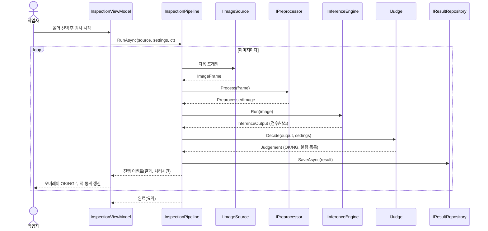
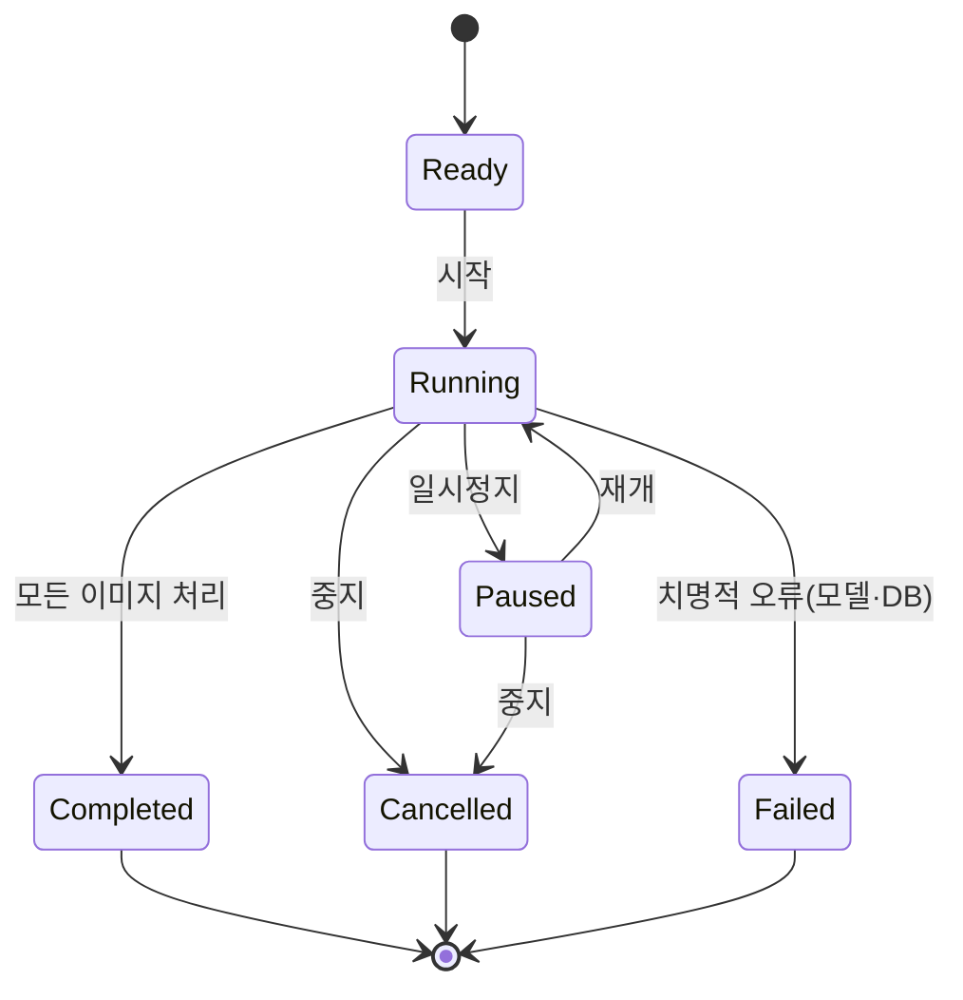
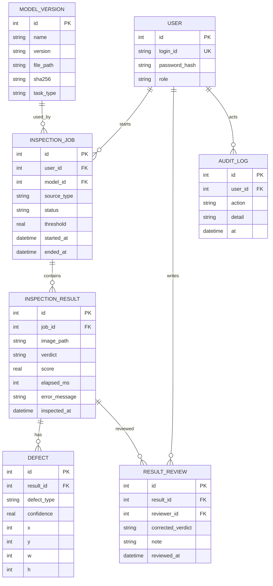

# VisionQC 설계서 (설계 단계)

작성일 2026-11-13 · 버전 0.1 · 입력: [01_분석서.md](01_분석서.md)

## 0. 분석서의 미확정 항목 — 설계상 잠정 결정

| 항목 | 잠정 결정 | 이유 / 변경 조건 |
|---|---|---|
| 접근 방식 | 분류 모델로 파이프라인 완성 → 검출(YOLO) 교체 | `IInferenceEngine`로 교체 가능하게 설계 |
| DB | SQLite (Microsoft.Data.Sqlite) | 설치 부담 없음. Repository 인터페이스 뒤에 두어 MariaDB로 교체 가능 |
| 데이터셋 | 후보: DeepPCB(검출), MVTec AD(이상검출) | **라이선스 확인 전 확정 아님** |
| 기간 | 8주 가정 (일정표는 별도 작성) | 사용자 확정 필요 |

잠정 결정이라 바꿔도 되고, 바꾸면 아래 설계 중 해당 부분만 수정하면 된다.

---

## 1. 아키텍처

### 1.1 솔루션 구조

```
VisionQC.sln
├─ VisionQC.Core/            도메인 모델, 인터페이스 (외부 의존 없음)
├─ VisionQC.Imaging/         IImageSource 구현 (폴더, UVC 카메라), OpenCvSharp 전처리
├─ VisionQC.Inference/       IInferenceEngine 구현 (OnnxClassifier, OnnxDetector)
├─ VisionQC.Data/            Repository 구현 (SQLite), 마이그레이션
├─ VisionQC.App/             WPF (View, ViewModel, 설정, DI 구성)
├─ VisionQC.Tests/           xUnit 단위·통합 테스트
├─ VisionQC.Eval/            모델 평가 콘솔 (혼동행렬, Recall/Precision, 처리시간)
└─ training/                 Python 학습·ONNX 변환 스크립트 (C# 솔루션 밖)
```

의존 방향: `App → Core ← (Imaging, Inference, Data)`. `Core`는 어떤 라이브러리도 참조하지 않는다(테스트 용이성, 교체 가능성).

### 1.2 계층

| 계층 | 역할 | 예 |
|---|---|---|
| Presentation | View(XAML), ViewModel(MVVM) | `InspectionView`, `InspectionViewModel` |
| Application | 검사 흐름 조율 | `InspectionPipeline`, `HistoryService`, `StatsService` |
| Domain | 모델·규칙 | `Judgement`, `DefectType`, `InspectionResult` |
| Infrastructure | 이미지·추론·DB | `FolderImageSource`, `OnnxDetector`, `SqliteResultRepository` |

### 1.3 핵심 인터페이스

```csharp
public interface IImageSource {                       // 폴더·카메라 추상화 (FR-02)
    string Name { get; }
    IAsyncEnumerable<ImageFrame> ReadAsync(CancellationToken ct);
}

public interface IPreprocessor {                      // FR-03
    PreprocessedImage Process(ImageFrame frame, InspectionSettings s);
}

public interface IInferenceEngine {                   // FR-04, 모델 교체점
    ModelInfo Model { get; }                          // 이름·버전·입력 크기
    InferenceOutput Run(PreprocessedImage image);     // 분류: 점수 / 검출: 박스 목록
}

public interface IJudge {                             // FR-05
    Judgement Decide(InferenceOutput output, InspectionSettings s);   // OK/NG + 불량 목록
}

public interface IResultRepository {                  // FR-07, 08
    Task SaveAsync(InspectionResult r, CancellationToken ct);
    Task<IReadOnlyList<InspectionResult>> QueryAsync(HistoryFilter f, CancellationToken ct);
}
```

판정 로직(`IJudge`)을 추론과 분리한 이유: 임계값을 바꿔도 모델을 다시 돌리지 않고 **저장된 점수로 재판정**할 수 있고(FR-09), 판정 규칙을 모델 없이 단위 테스트할 수 있다.

### 1.4 스레드·동시성 설계

- UI 스레드는 화면 갱신만. 검사는 `Task` 위에서 **생산자-소비자** 구조로 돈다.

```
ImageSource ─▶ [Channel<ImageFrame>] ─▶ Preprocess+Infer worker ─▶ [Channel<InspectionResult>] ─▶ DB 저장 worker
                                                                         └▶ UI 갱신(Dispatcher, 최신 결과만)
```

- `System.Threading.Channels`의 bounded channel로 메모리 폭주를 막는다(용량 초과 시 읽기 측이 대기).
- `CancellationToken`으로 중지 지원. 중지해도 이미 추론된 결과는 저장한다.
- ONNX `InferenceSession`은 스레드 안전하므로 1개를 재사용하고, 워커 수는 설정값(기본 1)으로 둔다. **워커 수에 따른 처리량은 측정 후 결정**한다.
- OpenCvSharp `Mat`은 `IDisposable`이므로 소유권 규칙을 둔다: 생성한 쪽이 아닌 **마지막 소비자가 해제**, 파이프라인 경계에서는 `byte[]` 또는 복제본을 넘긴다. 누수 점검을 테스트 항목에 포함한다.

### 1.5 예외·오류 처리 정책

| 상황 | 처리 |
|---|---|
| 손상·미지원 이미지 | 결과 상태 `ERROR`로 기록(사유 포함), 다음 이미지 계속 |
| 모델 파일 누락/로드 실패 | 시작 시 검증, 검사 버튼 비활성 + 오류 안내 |
| 카메라 연결 끊김 | 재연결 시도 N회 후 중지·알림 |
| DB 저장 실패 | 재시도 후 로컬 파일 로그에 남기고 UI 경고 (검사는 계속) |

`ERROR`는 `OK`/`NG`와 별개 상태다. 판정 불능을 양품으로 처리하지 않는다.

---

## 2. 검사 처리 흐름

### 2.1 시퀀스: 폴더 일괄 검사



### 2.2 상태: 검사 회차(InspectionJob)



### 2.3 판정 규칙 (초안)

| 모델 | 규칙 |
|---|---|
| 분류 | `불량 점수 ≥ 임계값` → NG, 아니면 OK |
| 검출 | 신뢰도 ≥ 임계값인 박스가 1개 이상 → NG. 불량 유형별 임계값 개별 설정 가능 |
| 공통 | 추론 실패 → ERROR. **임계값 기본값은 검증 데이터 평가 후 정한다**(미검출 비용이 크므로 Recall 우선, 분석서 §5) |

---

## 3. 화면 설계

WPF 메인 윈도우 1개 + 탭/네비게이션.

### 3.1 검사 화면 (FR-01, 03~06, 13)

```
┌──────────────────────────────────────────────────────────────┐
│ [소스: 폴더▼] [경로…] [▶시작][⏸][■]   모델: v1.0   임계값 0.50 │
├───────────────────────────────┬──────────────────────────────┤
│                               │  판정      ┌──────┐          │
│   원본 이미지 + 불량 오버레이  │            │  NG  │ (큰 표시)│
│   (줌/팬)                     │            └──────┘          │
│                               │  처리시간  42 ms              │
│                               │  불량 목록 (유형·신뢰도·위치) │
├───────────────────────────────┴──────────────────────────────┤
│ 진행 37/120  OK 31  NG 5  ERROR 1  양품률 86%                 │
│ 최근 결과 썸네일 스트립 ▸▸▸                                   │
└──────────────────────────────────────────────────────────────┘
```

### 3.2 이력 화면 (FR-08, 09, 14)
필터(기간·판정·불량유형·모델버전) → DataGrid(시각·파일·판정·불량수·처리시간) → 선택 시 이미지+오버레이, **재판정/정정** 버튼(엔지니어 이상), CSV 내보내기.

### 3.3 통계 화면 (FR-10)
일별 양품률 선, 불량 유형 분포 막대, 처리시간 분포(평균·p95).

### 3.4 설정 화면 (FR-11, 12)
임계값, ROI 지정, 저장 경로, 모델 파일 선택·검증, 사용자·권한(관리자).

### 3.5 권한

| 기능 | 작업자 | 엔지니어 | 관리자 |
|---|---|---|---|
| 검사 실행·결과 조회 | ✔ | ✔ | ✔ |
| 재판정·정정 | | ✔ | ✔ |
| 임계값·모델 변경 | | ✔ | ✔ |
| 사용자·감사로그 | | | ✔ |

---

## 4. 데이터 설계 (요약 — 상세 정의는 데이터정의서에서)



설계 원칙
- 이미지 **파일 자체는 DB에 넣지 않고 경로·해시만** 저장(용량). 파일 이동·삭제 시 이력은 남고 이미지는 "없음"으로 표시.
- `INSPECTION_RESULT`에 판정 당시 `score`를 저장해 임계값 변경 후 **재판정**이 가능하게 한다. 사용된 임계값·모델은 `INSPECTION_JOB`에 기록(추적성).
- 정정(`RESULT_REVIEW`)은 원 판정을 덮어쓰지 않고 별도 행으로 쌓는다(이력 보존, 재학습 데이터 후보).
- 비밀번호는 해시(PBKDF2/Argon2)로 저장.

---

## 5. 모델 설계 (training/)

| 항목 | 내용 |
|---|---|
| 1차 | 사전학습 경량 CNN(예: MobileNet/ResNet18) 미세조정 → 양품/불량 분류 → ONNX |
| 2차 | YOLO 계열 소형 모델 → 검출 → ONNX. 입출력 텐서 형식을 `OnnxDetector`가 파싱 |
| 평가 | 학습/검증/시험 분할을 고정하고 시험셋은 학습에 쓰지 않음. 혼동행렬, Recall/Precision/F1, 처리시간 |
| 산출물 | `.onnx` 파일 + 모델 카드(데이터셋, 분할, 하이퍼파라미터, 지표) → `MODEL_VERSION`에 sha256과 함께 등록 |

모델 학습 결과는 아직 없다. 지표는 학습 후 실측값만 기록한다.

---

## 6. 테스트 설계 (구현 단계 입력)

| 구분 | 대상 | 방법 |
|---|---|---|
| 단위 | `IJudge` 임계값 경계, 전처리 크기·정규화, Repository 쿼리 | xUnit, 가짜 `IInferenceEngine` 사용(모델 없이 실행) |
| 통합 | 파이프라인 전체(폴더 → 가짜/실제 모델 → DB) | 임시 SQLite, 샘플 이미지 |
| 예외 | 손상 이미지, 모델 누락, 빈 폴더, 중도 취소 | 기대 상태(`ERROR`, 취소 후 저장) 검증 |
| 성능 | 100장 평균·p95 처리시간, 메모리 증가 추이(`Mat` 누수) | Eval 도구 + 로그 |
| UI | 로그인 → 검사 → 이력 조회 흐름 | FlaUI(가능한 범위) + 수동 체크리스트 |
| 모델 | 시험셋 Recall/Precision | `VisionQC.Eval` |

## 7. 요구사항 추적 (분석 → 설계)

| 요구 | 설계 반영 위치 |
|---|---|
| FR-01·02 이미지 입력/추상화 | `IImageSource`, Imaging 프로젝트 |
| FR-03 전처리 | `IPreprocessor` |
| FR-04 추론 | `IInferenceEngine`, Inference 프로젝트 |
| FR-05 판정 | `IJudge`, §2.3 |
| FR-06 결과 표시 | §3.1 |
| FR-07·08 이력 | `IResultRepository`, §3.2, §4 |
| FR-09 재판정 | `RESULT_REVIEW`, score 저장 |
| FR-10 통계 | §3.3, `StatsService` |
| FR-11·12 설정·권한 | §3.4, §3.5 |
| FR-13 연속 검사 | 생산자-소비자 파이프라인(§1.4) |
| 비기능: UI 비멈춤 | §1.4 |
| 비기능: 추적성 | `INSPECTION_JOB`의 모델·임계값 기록 |
| 비기능: 확장성 | 인터페이스 4종(§1.3) |

## 8. 다음 단계

구현 전에 확정할 것: ① 데이터셋·라이선스 ② 개발 기간(일정표 작성에 필요) ③ UVC 카메라 보유 여부(FR-01 카메라 범위).
