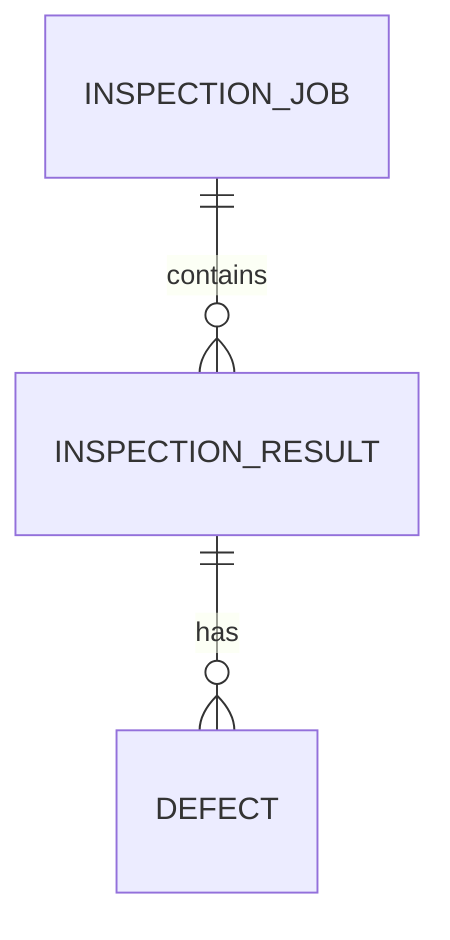

# VisionQC 데이터 정의서

작성일 2026-11-13 · 버전 1.0 · 기준 코드: `VisionQC.Data/SqliteResultRepository.cs`, `VisionQC.Core/Models.cs`, `training/`
설계서 §4의 ERD 중 **구현된 테이블**과 **계획 테이블**을 구분한다.

## 1. 저장소 개요

| 항목 | 내용 |
|---|---|
| DBMS | SQLite (WAL 모드, `foreign_keys=ON`, `busy_timeout=5000ms`) |
| 기본 경로 | `%LOCALAPPDATA%\VisionQC\visionqc.db` (실행 인자 `--db`로 변경) |
| 시각 | **UTC ISO-8601 문자열**(`2026-11-13T05:16:38.6729437Z`). 문자열 정렬 = 시간순. 화면 표시는 로컬 시간으로 변환 |
| 이미지 | DB에 넣지 않고 **파일 경로만** 저장 |
| 스키마 생성 | 저장소 생성 시 `CREATE TABLE IF NOT EXISTS` (별도 마이그레이션 도구 없음) |

## 2. ERD (구현분)

## 3. 테이블 정의 — 구현

### 3.1 `inspection_job` — 검사 회차
| 컬럼 | 타입 | NULL | 설명 |
|---|---|---|---|
| id | INTEGER PK AUTOINCREMENT | N | 회차 ID |
| model_name | TEXT | N | 모델 파일명 (예: `model.onnx`) |
| model_version | TEXT | N | 모델 파일 SHA-256 앞 12자리 (추적성) |
| source_name | TEXT | N | 입력 소스 (`folder:<경로>`) |
| status | TEXT | N | `Running` / `Completed` / `Cancelled` / `Failed` |
| threshold | REAL | N | 이 회차에 쓴 임계값 |
| started_at | TEXT | N | 시작(UTC) |
| ended_at | TEXT | Y | 종료(UTC). 비정상 종료 시 NULL로 남을 수 있음 |

### 3.2 `inspection_result` — 이미지 1장의 결과
| 컬럼 | 타입 | NULL | 설명 |
|---|---|---|---|
| id | INTEGER PK AUTOINCREMENT | N | 결과 ID |
| job_id | INTEGER FK → inspection_job.id | N | 소속 회차 |
| image_path | TEXT | N | 이미지 파일 경로 |
| verdict | TEXT | N | `OK` / `NG` / `ERROR` |
| score | REAL | N | 불량 점수(확률 0~1). 판정 불능(NaN)은 0으로 저장하고 verdict=ERROR |
| elapsed_ms | INTEGER | N | 전처리+추론+판정 시간(ms). 저장·화면 갱신 시간 제외 |
| error_message | TEXT | Y | ERROR 사유(손상 이미지, 추론 실패 등) |
| inspected_at | TEXT | N | 검사 시각(UTC) |

인덱스: `ix_result_time(inspected_at)`, `ix_result_verdict(verdict)`, `ix_result_job(job_id)`.

### 3.3 `defect` — 검출된 불량 1건 (검출 모델용)
| 컬럼 | 타입 | NULL | 설명 |
|---|---|---|---|
| id | INTEGER PK AUTOINCREMENT | N | |
| result_id | INTEGER FK → inspection_result.id, ON DELETE CASCADE | N | |
| defect_type | TEXT | N | 불량 유형명 |
| confidence | REAL | N | 신뢰도 0~1 |
| x, y, w, h | INTEGER | N | 박스(모델 입력 크기 기준 좌표) |

인덱스: `ix_defect_result(result_id)`. **현재 분류 모델은 박스를 내지 않으므로 이 테이블은 비어 있다.**

## 4. 테이블 정의 — 계획 (미구현)

| 테이블 | 용도 | 주요 컬럼 | 대응 요구 |
|---|---|---|---|
| `user` | 계정·권한 | id, login_id(UNIQUE), password_hash(PBKDF2/Argon2), role(`Operator`/`Engineer`/`Admin`) | FR-12 |
| `model_version` | 모델 등록부 | id, name, version, file_path, sha256, task_type | FR-04, 모델 교체 이력 |
| `result_review` | 재판정·정정(원 판정을 덮어쓰지 않고 행 추가) | id, result_id FK, reviewer_id FK, corrected_verdict, note, reviewed_at | FR-09 |
| `audit_log` | 감사 로그 | id, user_id FK, action, detail, at | FR-12 |

## 5. 코드값 (열거형)

| 이름 | 값 | 의미 |
|---|---|---|
| Verdict | OK | 점수 < 임계값 |
|  | NG | 점수 ≥ 임계값(경계값 포함) 또는 임계값 이상 박스 존재 |
|  | ERROR | 판정 불능(손상 이미지·추론 예외·점수 NaN/무한대). **양품으로 취급하지 않음** |
| JobStatus | Running / Completed / Cancelled / Failed | 회차 상태. Failed = 소스 오류 등 치명적 오류 |

## 6. 파일 데이터

### 6.1 학습 데이터셋 (`training/data`, 저장소 제외)
| 경로 | 설명 |
|---|---|
| `data/good/*` | 양품 이미지 — **클래스 인덱스 0** |
| `data/defect/*` | 불량 이미지 — **클래스 인덱스 1** |
| `data/manifest.csv` | 변환 추적: `file, label, defect_kind, source` (UTF-8 BOM) |

MVTec AD `metal_nut` 변환 결과: good 242장, defect 93장(bent·color·flip·scratch). 파일명 `train_good_0000.png`, `test_scratch_0003.png` 형식. 원본은 CC BY-NC-SA 4.0(비상업), 재배포 금지.

### 6.2 `out/split.json` — 고정 분할
`{"train": [[상대경로, 라벨], ...], "val": [...], "test": [...]}`. 클래스 비율 유지, seed 고정(기본 42), 비율 70/15/15. metal_nut 실제 분할: train 170+65 / val 36+14 / test 36+14 (양품+불량).

### 6.3 `out/report.json` — 평가 결과
`threshold_chosen_on_val`, `val_at_threshold`, `test_at_threshold`, `test_at_0.5`(각각 tp/fn/fp/tn/recall/precision/f1/miss_rate/false_alarm_rate), `n`, `inference_ms_cpu`(mean/p95, 모델 실행만).

### 6.4 `out/model_card.json` — 모델 카드
모델 파일명·sha256_12, 클래스, 입력 형상, 출력 정의, 전처리(mean/std 포함), 권장 임계값, 학습 설정(아키텍처·에폭·seed·증강·장치), 분할 장수, 에폭별 이력, 주의 문구.

## 7. 모델 입출력 규약 (C# ↔ 파이썬 계약)

| 항목 | 값 |
|---|---|
| 입력 | 이름은 모델이 정함(앱이 첫 입력 사용), float32 `[1,3,H,W]` (기본 H=W=224, 앱 `InputSize`와 일치해야 함) |
| 전처리 | 컬러 로드 → 정사각 리사이즈(INTER_AREA) → RGB → /255 → mean `(0.485,0.456,0.406)`, std `(0.229,0.224,0.225)` → CHW |
| 출력 | 첫 출력 텐서. 2개 이상: logits로 보고 softmax 후 **인덱스 1 = 불량 확률**. 1개: sigmoid |
| 클래스 | 0 = 양품, 1 = 불량 (폴더 알파벳순이 아니라 코드에서 고정) |
| 버전 | 파일 SHA-256 앞 12자리 |

계약 위반 시 판정이 조용히 틀리므로 `OnnxParityTests`로 파이썬↔C# 점수 일치(오차 < 1e-4)를 확인한다.

## 8. 메모리 내 데이터 (C#)

| 타입 | 주요 필드 |
|---|---|
| `ImageFrame` | Path |
| `PreprocessedImage` | Path, Data(float[]), Width, Height, OriginalWidth, OriginalHeight |
| `InferenceOutput` | Score, Detections |
| `Detection` | Type, Confidence, X, Y, W, H |
| `Judgement` | Verdict, Score, Defects, Reason |
| `InspectionSettings` | Threshold(0.5), InputSize(224), QueueCapacity(8), Workers(1) |
| `RunSummary` | JobId, Status, Total, Ok, Ng, Error, SaveFailures, FatalError |

## 9. 보관·보안 메모

- 이력 DB는 자동 삭제·백업이 없다(유지보수 단계에서 보관 기간·백업 절차 정의 예정).
- 이미지 경로가 이동·삭제되면 이력은 남고 이미지는 열리지 않는다(화면에 표시).
- 현재 계정·비밀번호 데이터는 없다(FR-12 미구현).
