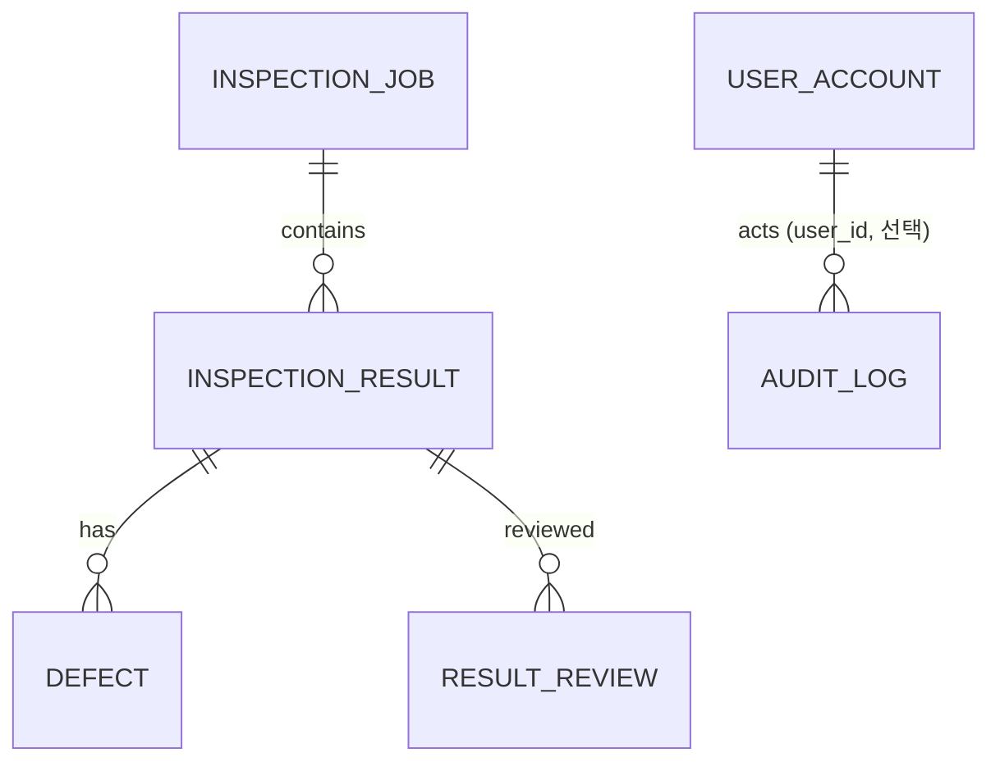

# VisionQC 데이터 정의서

작성일 2026-11-13 · 버전 1.0 · 기준 코드: `VisionQC.Data/SqliteResultRepository.cs`, `VisionQC.Core/Models.cs`, `training/`
설계서 §4의 ERD 중 **구현된 테이블**과 **계획 테이블**을 구분한다.

## 1. 저장소 개요

| 항목 | 내용 |
|---|---|
| DBMS | SQLite (WAL 모드, `foreign_keys=ON`, `busy_timeout=5000ms`) |
| 기본 경로 | `%LOCALAPPDATA%\VisionQC\visionqc.db` (실행 인자 `--db`로 변경) |
| 시각 | **UTC ISO-8601 문자열**(`2026-11-13T05:16:38.6729437Z`). 문자열 정렬 = 시간순. 화면 표시는 로컬 시간으로 변환 |
| 이미지 | DB에 넣지 않고 **파일 경로만** 저장 |
| 스키마 생성 | 저장소 생성 시 `CREATE TABLE IF NOT EXISTS` (별도 마이그레이션 도구 없음) |

## 2. ERD (구현분)

`result_review.reviewer`와 `audit_log.login_id`는 **아이디 문자열**로 저장한다(외래 키 아님) — 계정이 비활성화돼도, 로그인 실패처럼 계정이 없는 기록도 그대로 남기 위해서다.

## 3. 테이블 정의 — 구현

### 3.1 `inspection_job` — 검사 회차
| 컬럼 | 타입 | NULL | 설명 |
|---|---|---|---|
| id | INTEGER PK AUTOINCREMENT | N | 회차 ID |
| model_name | TEXT | N | 모델 파일명 (예: `model.onnx`) |
| model_version | TEXT | N | 모델 파일 SHA-256 앞 12자리 (추적성) |
| source_name | TEXT | N | 입력 소스 (`folder:<경로>`) |
| status | TEXT | N | `Running` / `Completed` / `Cancelled` / `Failed` |
| threshold | REAL | N | 이 회차에 쓴 임계값 |
| started_at | TEXT | N | 시작(UTC) |
| ended_at | TEXT | Y | 종료(UTC). 비정상 종료 시 NULL로 남을 수 있음 |

### 3.2 `inspection_result` — 이미지 1장의 결과
| 컬럼 | 타입 | NULL | 설명 |
|---|---|---|---|
| id | INTEGER PK AUTOINCREMENT | N | 결과 ID |
| job_id | INTEGER FK → inspection_job.id | N | 소속 회차 |
| image_path | TEXT | N | 이미지 파일 경로 |
| verdict | TEXT | N | `OK` / `NG` / `ERROR` |
| score | REAL | N | 불량 점수(확률 0~1). 판정 불능(NaN)은 0으로 저장하고 verdict=ERROR |
| elapsed_ms | INTEGER | N | 전처리+추론+판정 시간(ms). 저장·화면 갱신 시간 제외 |
| error_message | TEXT | Y | ERROR 사유(손상 이미지, 추론 실패 등) |
| inspected_at | TEXT | N | 검사 시각(UTC) |

인덱스: `ix_result_time(inspected_at)`, `ix_result_verdict(verdict)`, `ix_result_job(job_id)`.

### 3.3 `defect` — 검출된 불량 1건 (검출 모델용)
| 컬럼 | 타입 | NULL | 설명 |
|---|---|---|---|
| id | INTEGER PK AUTOINCREMENT | N | |
| result_id | INTEGER FK → inspection_result.id, ON DELETE CASCADE | N | |
| defect_type | TEXT | N | 불량 유형명 |
| confidence | REAL | N | 신뢰도 0~1 |
| x, y, w, h | INTEGER | N | 박스(모델 입력 크기 기준 좌표) |

인덱스: `ix_defect_result(result_id)`. **현재 분류 모델은 박스를 내지 않으므로 이 테이블은 비어 있다.**

### 3.4 `result_review` — 정정 기록 (FR-09)
원 판정(`inspection_result.verdict`)은 **절대 바꾸지 않고** 정정을 행으로 추가한다. 한 결과에 정정이 여러 번 있으면 **id가 가장 큰(나중) 행이 유효**.

| 컬럼 | 타입 | NULL | 설명 |
|---|---|---|---|
| id | INTEGER PK AUTOINCREMENT | N | 정정 ID (클수록 나중) |
| result_id | INTEGER FK → inspection_result.id, ON DELETE CASCADE | N | 대상 결과. 없는 ID면 FK 위반으로 거부 |
| reviewer | TEXT | N | 정정한 사람의 **로그인 아이디**(이전 버전에서 쌓인 행은 Windows 사용자 이름일 수 있음) |
| corrected_verdict | TEXT CHECK IN ('OK','NG') | N | 정정한 판정. ERROR는 불가 |
| note | TEXT | Y | 메모(최대 500자, 앞뒤 공백 제거, 빈 문자열은 NULL) |
| reviewed_at | TEXT | N | 정정 시각(UTC) |

인덱스: `ix_review_result(result_id)`. 이전 버전 DB도 열 때 `CREATE TABLE IF NOT EXISTS`로 이 테이블이 생긴다(테스트로 확인).

파생 개념(저장하지 않음): **유효 판정** = 가장 나중 정정이 있으면 그 값, 없으면 원 판정. **오판** = 유효 판정 ≠ 원 판정.

### 3.5 `user_account` — 계정 (FR-12)
설계서의 `user`는 SQL 예약어와 겹치지 않도록 `user_account`로 만들었다.

| 컬럼 | 타입 | NULL | 설명 |
|---|---|---|---|
| id | INTEGER PK AUTOINCREMENT | N | |
| login_id | TEXT UNIQUE **COLLATE NOCASE** | N | 아이디(대소문자 구분 없이 유일). 영문·숫자·`_ . -` 3~32자 |
| password_hash | TEXT | N | `PBKDF2-SHA256$600000$<salt b64>$<hash b64>` (평문 저장 없음, 계정마다 다른 salt) |
| role | TEXT CHECK IN ('Operator','Engineer','Admin') | N | 역할 |
| active | INTEGER (0/1) | N | 비활성이면 로그인 불가(계정은 삭제하지 않음 — 감사 기록 보존) |
| failed_count | INTEGER | N | 연속 로그인 실패 횟수(성공·관리자 재설정 시 0) |
| locked_until | TEXT | Y | 잠금 해제 시각(UTC). 5회 실패 시 +10분 |
| created_at | TEXT | N | 생성 시각(UTC) |

### 3.6 `audit_log` — 감사 로그 (FR-12)
**추가·조회만** 한다(저장소 API에 수정·삭제 없음). DB 파일을 직접 고치는 것까지 막지는 못한다.

| 컬럼 | 타입 | NULL | 설명 |
|---|---|---|---|
| id | INTEGER PK AUTOINCREMENT | N | |
| at | TEXT | N | 시각(UTC) |
| user_id | INTEGER | Y | 사용자 ID. 없는 아이디로 로그인 실패한 기록은 NULL |
| login_id | TEXT | N | 아이디 문자열(없는 아이디로 시도한 값 포함) |
| action | TEXT | N | 동작 코드(§5) |
| detail | TEXT | Y | 상세. **비밀번호는 절대 넣지 않음** |

인덱스: `ix_audit_at(at)`, `ix_audit_action(action)`.

## 4. 테이블 정의 — 계획 (미구현)

| 테이블 | 용도 | 주요 컬럼 | 대응 요구 |
|---|---|---|---|
| `model_version` | 모델 등록부 | id, name, version, file_path, sha256, task_type | FR-04, 모델 교체 이력 |

## 5. 코드값 (열거형)

| 이름 | 값 | 의미 |
|---|---|---|
| Verdict | OK | 점수 < 임계값 |
|  | NG | 점수 ≥ 임계값(경계값 포함) 또는 임계값 이상 박스 존재 |
|  | ERROR | 판정 불능(손상 이미지·추론 예외·점수 NaN/무한대). **양품으로 취급하지 않음** |
| JobStatus | Running / Completed / Cancelled / Failed | 회차 상태. Failed = 소스 오류 등 치명적 오류 |
| Role | Operator / Engineer / Admin | 작업자(검사·이력·통계) / 엔지니어(+재판정·설정) / 관리자(+사용자 관리·감사 로그) |
| Permission | RunInspection, ViewHistory, ViewStats, ReviewResults, ChangeSettings, ManageUsers, ViewAudit | `Permissions.Has(role, permission)` |
| 감사 동작 | login.success / login.fail / login.locked / logout | 로그인·잠금·로그아웃 |
|  | session.timeout | 무조작 자동 로그아웃(`무조작 N분`) |
|  | db.backup | DB 백업(파일명·크기·정리한 개수) |
|  | inspection.start / inspection.end | 검사 시작·종료(폴더·모델 버전·임계값·요약) |
|  | review.correct | 정정(원 판정→정정 판정, 메모) |
|  | settings.change | 설정 변경(전→후 값) |
|  | user.create / user.activate / user.deactivate | 사용자 관리 |
|  | password.change / password.reset | 본인 변경 / 관리자 재설정 |

## 6. 파일 데이터

### 6.1 학습 데이터셋 (`training/data`, 저장소 제외)
| 경로 | 설명 |
|---|---|
| `data/good/*` | 양품 이미지 — **클래스 인덱스 0** |
| `data/defect/*` | 불량 이미지 — **클래스 인덱스 1** |
| `data/manifest.csv` | 변환 추적: `file, label, defect_kind, source` (UTF-8 BOM) |

MVTec AD `metal_nut` 변환 결과: good 242장, defect 93장(bent·color·flip·scratch). 파일명 `train_good_0000.png`, `test_scratch_0003.png` 형식. 원본은 CC BY-NC-SA 4.0(비상업), 재배포 금지.

### 6.2 `out/split.json` — 고정 분할
`{"train": [[상대경로, 라벨], ...], "val": [...], "test": [...]}`. 클래스 비율 유지, seed 고정(기본 42), 비율 70/15/15. metal_nut 실제 분할: train 170+65 / val 36+14 / test 36+14 (양품+불량).

### 6.3 `out/report.json` — 평가 결과
`threshold_chosen_on_val`, `val_at_threshold`, `test_at_threshold`, `test_at_0.5`(각각 tp/fn/fp/tn/recall/precision/f1/miss_rate/false_alarm_rate), `n`, `inference_ms_cpu`(mean/p95, 모델 실행만).

### 6.4 `out/model_card.json` — 모델 카드
모델 파일명·sha256_12, 클래스, 입력 형상, 출력 정의, 전처리(mean/std 포함), 권장 임계값, 학습 설정(아키텍처·에폭·seed·증강·장치), 분할 장수, 에폭별 이력, 주의 문구.

## 7. 모델 입출력 규약 (C# ↔ 파이썬 계약)

| 항목 | 값 |
|---|---|
| 입력 | 이름은 모델이 정함(앱이 첫 입력 사용), float32 `[1,3,H,W]` (기본 H=W=224, 앱 `InputSize`와 일치해야 함) |
| 전처리 | 컬러 로드 → 정사각 리사이즈(INTER_AREA) → RGB → /255 → mean `(0.485,0.456,0.406)`, std `(0.229,0.224,0.225)` → CHW |
| 출력 | 첫 출력 텐서. 2개 이상: logits로 보고 softmax 후 **인덱스 1 = 불량 확률**. 1개: sigmoid |
| 클래스 | 0 = 양품, 1 = 불량 (폴더 알파벳순이 아니라 코드에서 고정) |
| 버전 | 파일 SHA-256 앞 12자리 |

계약 위반 시 판정이 조용히 틀리므로 `OnnxParityTests`로 파이썬↔C# 점수 일치(오차 < 1e-4)를 확인한다.

## 8. 메모리 내 데이터 (C#)

| 타입 | 주요 필드 |
|---|---|
| `ImageFrame` | Path |
| `PreprocessedImage` | Path, Data(float[]), Width, Height, OriginalWidth, OriginalHeight |
| `InferenceOutput` | Score, Detections |
| `Detection` | Type, Confidence, X, Y, W, H |
| `Judgement` | Verdict, Score, Defects, Reason |
| `InspectionSettings` | Threshold(0.5), InputSize(224), QueueCapacity(8), Workers(1) |
| `RunSummary` | JobId, Status, Total, Ok, Ng, Error, SaveFailures, FatalError |
| `StatRow` / `DefectCount` / `StatsData` | 통계용 원본 행(검사 시각 UTC·판정·처리시간)과 불량 유형별 건수 — DB 조회 결과 |
| `StatsSummary` | Total, Ok, Ng, Error, YieldRate, Daily(`DailyStat`), DefectTypes, Time(`TimeStats`) — 계산 결과 |
| `Review` / `ReviewedResult` | 정정 1건(Id, ResultId, Reviewer, Corrected, Note, ReviewedAtUtc) / 결과 + 가장 나중 정정 + 정정 횟수(EffectiveVerdict, IsMisjudged) |
| `RejudgePreview` / `TruthEvaluation` | 임계값 변경 시 판정이 바뀌는 건수 / 정정된 건을 정답으로 본 혼동행렬(재현율·정밀도) — 저장하지 않는 계산 결과 |

### 통계 집계 규칙 (FR-10)

| 항목 | 규칙 |
|---|---|
| 양품률 | OK ÷ (OK + NG). ERROR는 분모에서 제외. OK+NG가 0이면 값 없음(0%가 아님) |
| 일 단위 | 저장은 UTC, 집계는 **로컬 달력 날짜**(UTC 15:30 → 한국 다음 날 00:30). 검사가 없던 날은 행을 만들지 않음 |
| 처리시간 | OK/NG만 대상. 평균, p95(최근접 순위: 정렬한 n개 중 ⌈0.95·n⌉번째), 최대, 구간 분포(<10 / 10~20 / 20~50 / 50~100 / 100~200 / 200ms+) |
| 불량 유형 | `defect` 테이블을 기간 조건으로 조인해 유형별 건수. 분류 모델은 `defect`를 쓰지 않으므로 현재 비어 있음 |
| 기간 | 화면 입력은 로컬 날짜(종료일 포함)를 UTC 경계로 변환해 조회 |

## 9. 보관·보안 메모

- 이력 DB는 자동 삭제·백업이 없다(유지보수 단계에서 보관 기간·백업 절차 정의 예정).
- 이미지 경로가 이동·삭제되면 이력은 남고 이미지는 열리지 않는다(화면에 표시).
- 계정 데이터에는 비밀번호 해시만 있고 평문은 어디에도 없다. 세션 만료(자동 로그아웃)와 계정 삭제는 아직 없다.

## 9-1. 백업 파일

| 항목 | 내용 |
|---|---|
| 이름 | `visionqc_YYYYMMDD_HHMMSS.db`(같은 초에 또 만들면 `_2`, `_3` …). 위치 `%LOCALAPPDATA%\VisionQC\backup`(`--backup-dir`) |
| 생성 | SQLite `VACUUM INTO` — 한 시점의 일관된 사본(WAL 보조 파일 불필요). 만든 뒤 `PRAGMA integrity_check`가 `ok`여야 성공, 실패하면 반쪽 사본을 지운다 |
| 내용 | 검사 이력·정정·**계정(비밀번호 해시)·감사 로그** 전체 → 접근 권한을 DB와 같게 관리 |
| 보관 | 이름순(= 시각순)으로 최신 10개만 남김. 이름 형식이 다른 파일은 건드리지 않음 |
| 복원 | 앱이 하지 않음. 수동 절차는 [08_운영유지보수가이드.md](08_운영유지보수가이드.md) §5 |

## 10. 설정 파일 (`settings.json`)

`%LOCALAPPDATA%\VisionQC\settings.json` (실행 인자 `--settings`로 변경). JSON, camelCase, 한글 경로 그대로 저장.

| 키 | 타입 | 기본값 | 설명 |
|---|---|---|---|
| folderPath | 문자열 | "" | 마지막으로 쓴 이미지 폴더(누구나 갱신) |
| modelPath | 문자열 | "" | ONNX 모델 경로(엔지니어 이상) |
| threshold | 숫자 0~1 | 0.5 | 불량 점수 ≥ 임계값이면 NG. 범위 밖이면 읽을 때 보정 |
| roi | 객체 또는 null | null | `{x, y, w, h}` 이미지 대비 비율(0~1). 폭·높이 ≥ 0.05, x+w ≤ 1, y+h ≤ 1. 잘못되면 읽을 때 무시 |
| idleTimeoutMinutes | 정수 1~480 | 15 | 무조작 자동 로그아웃(분). 검사·감시 중에는 적용 안 됨. 범위 밖이면 읽을 때 15로 되돌림. 이 키가 없는 이전 버전 파일은 기본값 15 |

쓰기: `settings.json.tmp`에 쓴 뒤 교체(도중에 꺼져도 기존 파일 유지). 읽기: 파일 없음 → 기본값, 깨짐 → 기본값 + 화면 경고.
실행 인자 `--model --threshold --folder`는 그 실행에서만 덮어쓰며 파일에 쓰지 않는다.
