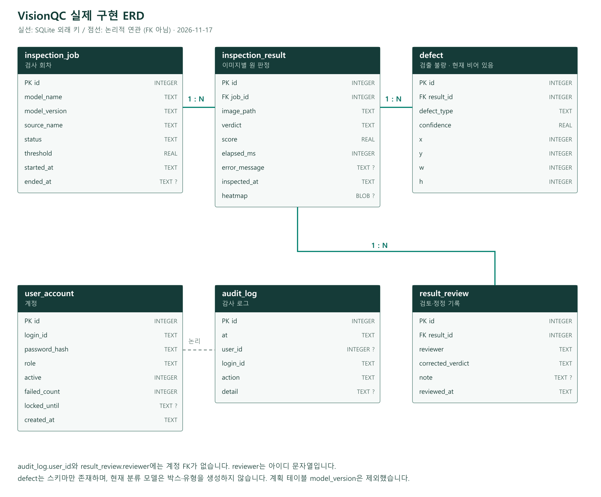

# VisionQC 데이터 정의서와 ERD

기준일: 2026-11-17 · 문서 버전: 2.0

기준: https://github.com/mycom0216/VisionQC/tree/b7ed874 + 이번 로컬 개선 코드. 기존 개발 이력은 저장소 자료이며, 이번 검증은 별도 표기합니다.

## 1. 저장 정책과 실제 ERD
SQLite 6개 테이블을 실제 시연 DB의 PRAGMA로 확인했다. 그림의 실선은 실제 외래 키, 점선은 문자열/ID 기반 논리적 연관이다. audit_log.user_id는 외래 키 선언이 없다. result_review.reviewer는 문자열이며 user_account와 FK가 아니다. defect는 테이블이 존재하지만 현재 분류 모델은 행을 저장하지 않는다. model_version 테이블은 미구현이므로 실제 ERD에 넣지 않았다.

## 2. 공통 코드·단위
시간은 TEXT의 UTC ISO 8601, 화면은 로컬 변환. score/confidence는 실수, elapsed_ms는 정수 밀리초다. verdict=OK/NG/ERROR, job status=Running/Completed/Cancelled/Failed, role=Operator/Engineer/Admin. 비밀번호는 PBKDF2-SHA256(600,000) salt/hash 문자열이다. 저장소의 user_id와 문자열 아이디는 구분한다.

## 3. inspection_job — 검사 회차

| 컬럼 | SQLite 타입 | NULL 허용 | 키/기본값 | 설명 |
|---|---|---|---|---|
| id | INTEGER | N | PK | 자동 증가 식별자 |
| model_name | TEXT | N | — | ONNX 파일명 |
| model_version | TEXT | N | — | 모델 파일 SHA-256 앞 12자리 |
| source_name | TEXT | N | — | 입력 소스 식별자·경로 |
| status | TEXT | N | — | 회차 상태 |
| threshold | REAL | N | — | 해당 회차 판정 임계값 |
| started_at | TEXT | N | — | 회차 시작 UTC |
| ended_at | TEXT | Y | — | 회차 종료 UTC, 비정상 종료 시 NULL 가능 |

실제 FK: 없음.

## 4. inspection_result — 이미지별 원 판정

| 컬럼 | SQLite 타입 | NULL 허용 | 키/기본값 | 설명 |
|---|---|---|---|---|
| id | INTEGER | N | PK | 자동 증가 식별자 |
| job_id | INTEGER | N | — | 소속 inspection_job.id FK |
| image_path | TEXT | N | — | 원본 이미지 경로(이미지 자체 아님) |
| verdict | TEXT | N | — | 원 판정 OK/NG/ERROR |
| score | REAL | N | — | 불량 확률. 판정 불능은 ERROR와 사유 확인 |
| elapsed_ms | INTEGER | N | — | 전처리+추론+판정 시간, 저장·UI 제외 |
| error_message | TEXT | Y | — | ERROR 사유 |
| inspected_at | TEXT | N | — | 검사 UTC |
| heatmap | BLOB | Y | — | VHM1 이진 CAM, NG에서만 보존 |

실제 FK: job_id → inspection_job.id, ON DELETE NO ACTION.

인덱스: `ix_result_job`, `ix_result_verdict`, `ix_result_time`.

## 5. defect — 검출 불량(현재 분류 모델은 행을 생성하지 않음)

| 컬럼 | SQLite 타입 | NULL 허용 | 키/기본값 | 설명 |
|---|---|---|---|---|
| id | INTEGER | N | PK | 자동 증가 식별자 |
| result_id | INTEGER | N | — | inspection_result.id FK, ON DELETE CASCADE |
| defect_type | TEXT | N | — | 검출 모델의 불량 유형명 |
| confidence | REAL | N | — | 검출 신뢰도 |
| x | INTEGER | N | — | 모델 입력 좌표 X |
| y | INTEGER | N | — | 모델 입력 좌표 Y |
| w | INTEGER | N | — | 박스 폭 |
| h | INTEGER | N | — | 박스 높이 |

실제 FK: result_id → inspection_result.id, ON DELETE CASCADE.

인덱스: `ix_defect_result`.

## 6. result_review — 추가 정정·확인 기록

| 컬럼 | SQLite 타입 | NULL 허용 | 키/기본값 | 설명 |
|---|---|---|---|---|
| id | INTEGER | N | PK | 자동 증가 식별자 |
| result_id | INTEGER | N | — | inspection_result.id FK, ON DELETE CASCADE |
| reviewer | TEXT | N | — | 정정자 로그인 아이디 문자열, FK 아님 |
| corrected_verdict | TEXT | N | — | OK/NG만 허용 |
| note | TEXT | Y | — | 선택 메모, 앱에서 최대 500자 |
| reviewed_at | TEXT | N | — | 검토 UTC |

실제 FK: result_id → inspection_result.id, ON DELETE CASCADE.

인덱스: `ix_review_result`.

## 7. user_account — 사용자 계정

| 컬럼 | SQLite 타입 | NULL 허용 | 키/기본값 | 설명 |
|---|---|---|---|---|
| id | INTEGER | N | PK | 자동 증가 식별자 |
| login_id | TEXT | N | — | 계정 아이디(계정 테이블 NOCASE UNIQUE); 감사에는 시도한 값 보존 |
| password_hash | TEXT | N | — | salt 포함 PBKDF2 해시, 평문 금지 |
| role | TEXT | N | — | Operator/Engineer/Admin CHECK |
| active | INTEGER | N | DEFAULT 1 | 1 활성, 0 비활성 |
| failed_count | INTEGER | N | DEFAULT 0 | 연속 실패 횟수 |
| locked_until | TEXT | Y | — | 잠금 해제 UTC 또는 NULL |
| created_at | TEXT | N | — | 생성 UTC |

실제 FK: 없음.

인덱스: `sqlite_autoindex_user_account_1`.

## 8. audit_log — 감사 로그

| 컬럼 | SQLite 타입 | NULL 허용 | 키/기본값 | 설명 |
|---|---|---|---|---|
| id | INTEGER | N | PK | 자동 증가 식별자 |
| at | TEXT | N | — | 감사 시각 UTC |
| user_id | INTEGER | Y | — | 선택 사용자 ID. FK 아님, 없는 아이디 로그인 실패는 NULL |
| login_id | TEXT | N | — | 계정 아이디(계정 테이블 NOCASE UNIQUE); 감사에는 시도한 값 보존 |
| action | TEXT | N | — | login.success / inspection.start / review.correct / db.backup 등 동작 |
| detail | TEXT | Y | — | 동작 상세; 비밀번호 기록 금지 |

실제 FK: 없음.

인덱스: `ix_audit_action`, `ix_audit_at`.

## 9. 파일·이진 데이터 규약
CAM BLOB은 VHM1 매직 4바이트 + int32 W,H + float32 영역 X,Y,W,H + float32 W×H 값이다. little-endian, 7×7이면 224바이트다. 크기·길이·유한값이 맞지 않으면 히트맵 없음으로 처리한다. 원본 이미지·CAM 자체는 검출 정답 마스크가 아니다.

settings.json은 모델 경로·폴더·임계값·ROI·idleTimeoutMinutes·autoBackupHours를 담는다. split.json은 train/val/test의 (상대 경로,라벨) 목록, report.json은 기존 평가 결과, model_card.json은 학습·입출력 메타데이터다. CSV 열은 result_id, job_id, inspected_at_utc, original_verdict, defect_score, elapsed_ms, image_path, error_message다. 최신 정정은 포함하지 않는다.

## 10. 무결성과 보존
계정은 비활성화로 관리한다. 검토자 문자열과 감사 문자열은 계정 수명과 독립적으로 남는다. 원 판정은 덮어쓰지 않는다. 검토·불량은 결과 삭제 시 cascade지만 회차는 별도 정리 정책이 필요하다. 이미지 이동 시 경로가 깨지므로 이미지 파일 보존도 함께 관리한다. 백업 DB에는 계정 해시가 포함되므로 배포 자료에 넣지 않는다.
