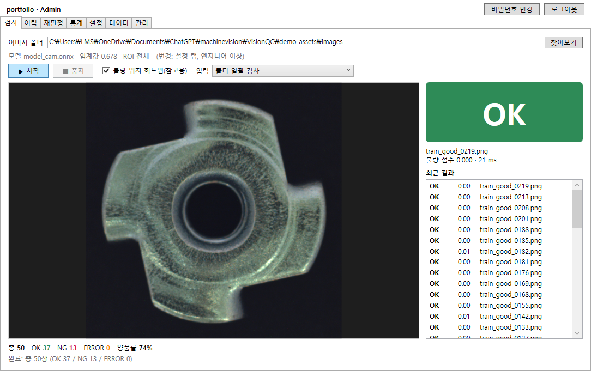
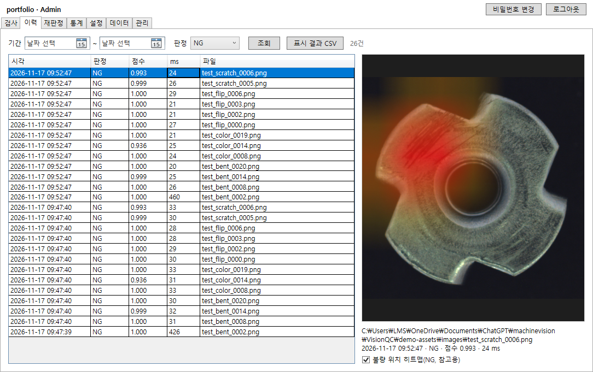
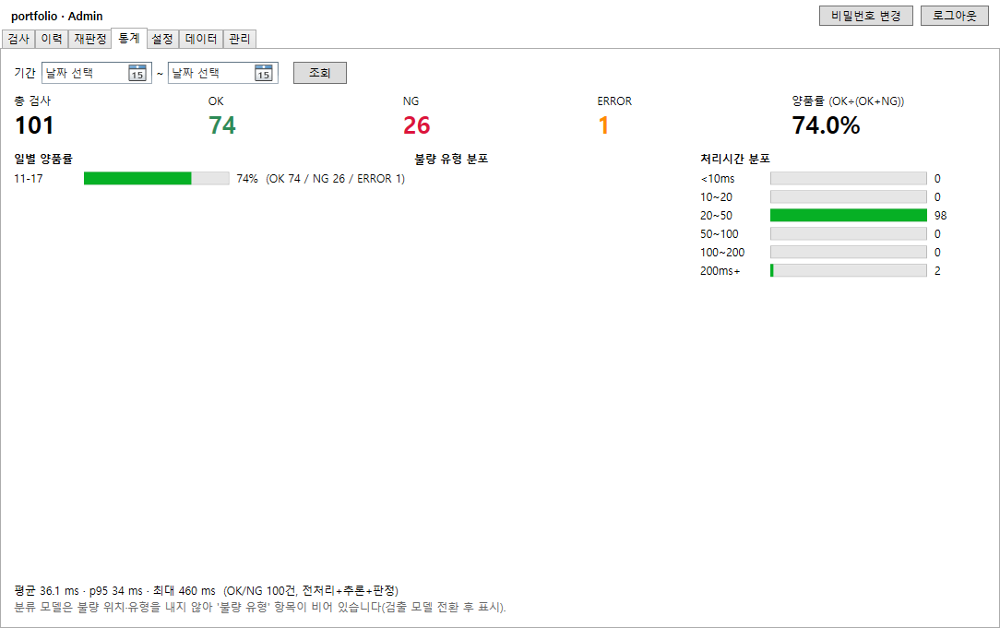

# VisionQC 프로젝트 포트폴리오

기준일: 2026-11-17 · 문서 버전: 2.0

기준: https://github.com/mycom0216/VisionQC/tree/b7ed874 + 이번 로컬 개선 코드. 기존 개발 이력은 저장소 자료이며, 이번 검증은 별도 표기합니다.

## 1. 프로젝트 소개
VisionQC는 C# WPF 기반 AI 외관검사 프로젝트다. 이미지 입력에서 ONNX 분류, 결과 이력, 엔지니어 검토, 통계·권한·백업까지 연결한다. GitHub 계정은 mycom0216이며 개인 이름·정확한 개발 기간·개인별 기여율은 자료에서 임의로 확정하지 않았다. 지원서에 기재할 때 실제 작업 범위와 기간을 확인해야 한다.

## 2. 보여줄 구현 역량
검사 도메인의 OK/NG/ERROR 구분과 비동기 생산자·소비자 처리, 인터페이스를 통한 입력·추론·저장 교체, Python↔C# 전처리 계약, SQLite 데이터 추적, 역할과 계정 잠금, 원 판정 보존형 정정, 복구 절차를 설명할 수 있다. 이번에는 조회 결과 CSV와 날짜 검증을 추가하고 실제 모델·화면을 다시 검증했다.

## 3. 대표 화면

## 4. 해결한 문제와 설계 판단
| 문제 | 구현한 해결 | 근거와 한계 |
|---|---|---|
| 일부 이미지 실패로 전체 검사가 중단됨 | 한 장 예외를 ERROR로 기록하고 계속 | 손상 이미지 fixture에서 ERROR 1 확인 |
| 화면·추론·DB 결합으로 교체 어려움 | Core 인터페이스와 계층 분리 | Core/Imaging/Inference/Data/App |
| 오판 수정 후 원 기록 소실 | 정정을 별도 행으로 추가 | 최신 review id 적용; 원 판정 통계는 별도 |
| 분류 결과를 박스 검출로 오해 | CAM 참고 위치와 제한 공개 | 7×7, 정확한 경계·유형 없음 |
| 검사 결과 공유가 번거로움 | 조회된 원 판정 CSV | 500건 한계, 수식 보호, BOM·인용 처리 |
| 날짜를 반대로 선택해 빈 결과로 오해 | 세 조회 화면에 공통 범위 검증 | 현지 달력 날짜→UTC, 같은 날 포함 |

## 5. 검증 결과
C# 207건, Python 24건 회귀 통과. 추가로 실제 모델의 Python·C# 점수 비교와 CAM logits 보존 검사를 2건 실행해 통과했다. 2건은 전체 207건에 포함되는 테스트의 모델 활성 재실행이며 더해 209건이라고 부르지 않는다. 기존 고정 시험셋 50장(불량 14) 재검증: TP13/FN1/FP0/TN36, 불량 재현율 92.9%, 정밀도 100%, 정확도 98%. 신규 외부 시험셋이나 현장 성능이 아니다.

이번 시연 준비 파이프라인(초기 호출 포함)은 OK/NG 50건 평균 39.2ms, p95 37ms, 최대 426ms였다. p95보다 평균이 큰 것은 초기 느린 호출의 영향이다. UI·DB·종단간 처리 시간으로 주장하지 않는다. 별도 UI 재검사 누적 통계 화면은 100건과 손상 입력 1건을 포함하며 숫자가 다르다.

## 6. 한계와 후속 방향
현재는 이진 분류+CAM이다. 실카메라, 장시간 연속 운전, 검출 모델의 박스·유형, 자동 모델 등록·배포, 생산라인 연동은 완료하지 않았다. MVTec의 정상 이미지를 자체 분할한 학습용 평가이며 실제 현장 일반화 근거로 부족하다. 불량 유형별 박스를 보여주려면 라벨 정책과 별도 검출 학습·평가가 필요하다.

## 7. 면접에서 사용할 설명 예시
“AI 결과를 표시하는 데서 끝내지 않고 원 판정과 정정을 분리해 추적 가능하게 만들었습니다. 이미지 오류는 양품으로 흘려보내지 않고 ERROR로 구분합니다. Python과 C#에서 전처리·출력 계약이 다르면 판정이 바뀔 수 있어 실제 모델의 점수 일치도 검사했습니다. 작은 시험셋의 결과이므로 현장 정확도라고 확대하지 않았습니다.”

위 설명은 코드 근거가 있는 기술 설명 초안이다. 발표자 본인이 담당한 범위와 일치하는지 확인한 뒤 본인 경험으로 사용한다.
