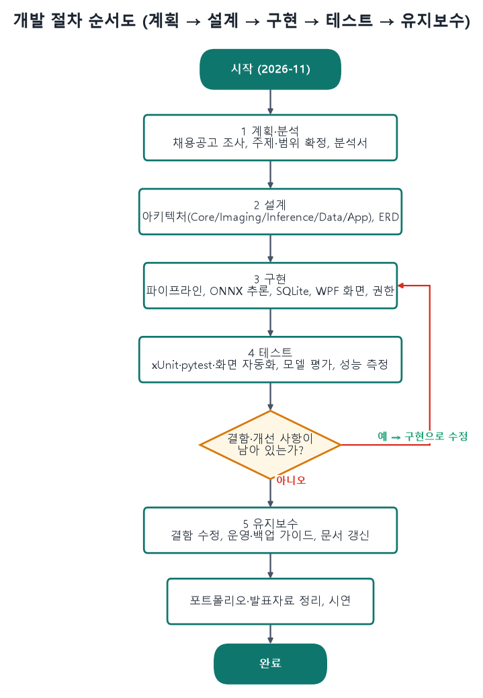
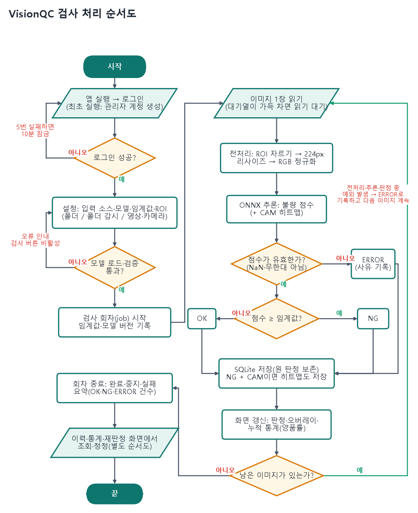
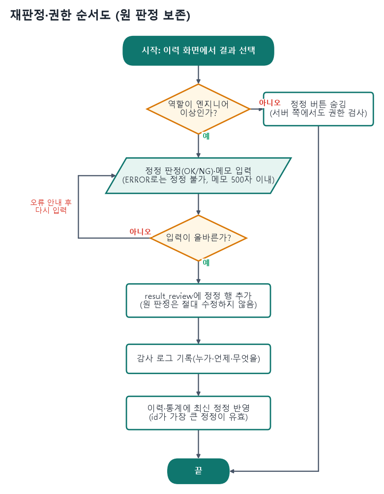

# VisionQC 순서도

작성 2026-11-26 · 작성자 반재영 · 표준 순서도 기호(둥근 사각형=시작·끝, 사각형=처리, 마름모=판단, 평행사변형=입출력)

## 1. 개발 절차 순서도

계획·분석 → 설계 → 구현 → 테스트 → 유지보수의 순서로 진행하며, 테스트에서 결함이나 개선 사항이 나오면 구현 단계로 돌아가 수정합니다.

## 2. 검사 처리 순서도

| 단계 | 설명 |
|---|---|
| 로그인 | 최초 실행이면 관리자 계정을 만듭니다. 로그인에 5번 실패하면 10분간 잠깁니다. |
| 설정 | 입력 소스(폴더·폴더 감시·영상/카메라), 모델 파일, 임계값, ROI를 정합니다. 모델이 열리지 않으면 검사 버튼을 막고 이유를 안내합니다. |
| 회차 시작 | 사용한 임계값과 모델 버전을 기록한 검사 회차를 만듭니다(나중에 같은 조건을 추적하기 위함). |
| 이미지 처리 반복 | 이미지를 대기열(가득 차면 읽기 대기)에서 하나씩 꺼내 전처리 → ONNX 추론 → 판정합니다. 점수가 유효하지 않거나 중간에 예외가 나면 ERROR로 기록하고 다음 이미지를 계속 처리합니다(판정 불능을 양품으로 처리하지 않음). |
| 판정 | 불량 점수가 임계값 이상이면 NG, 아니면 OK. |
| 저장·표시 | 원 판정을 SQLite에 저장하고(NG이고 CAM이 있으면 히트맵도 저장) 화면에 판정·누적 통계를 갱신합니다. |
| 종료 | 완료·중지·실패 상태와 OK·NG·ERROR 건수를 요약하고, 이후 이력·통계·재판정 화면에서 조회합니다. |

## 3. 재판정·권한 순서도

재판정(정정)은 엔지니어 이상만 할 수 있고, **원 판정은 절대 수정하지 않고** `result_review`에 정정 행을 추가합니다. 같은 결과에 정정이 여러 번 있으면 id가 가장 큰(나중) 정정이 유효하며, 모든 정정은 감사 로그에 남습니다. 권한은 화면에서 버튼을 숨기는 것에 그치지 않고 서버 쪽 로직에서도 검사합니다.
